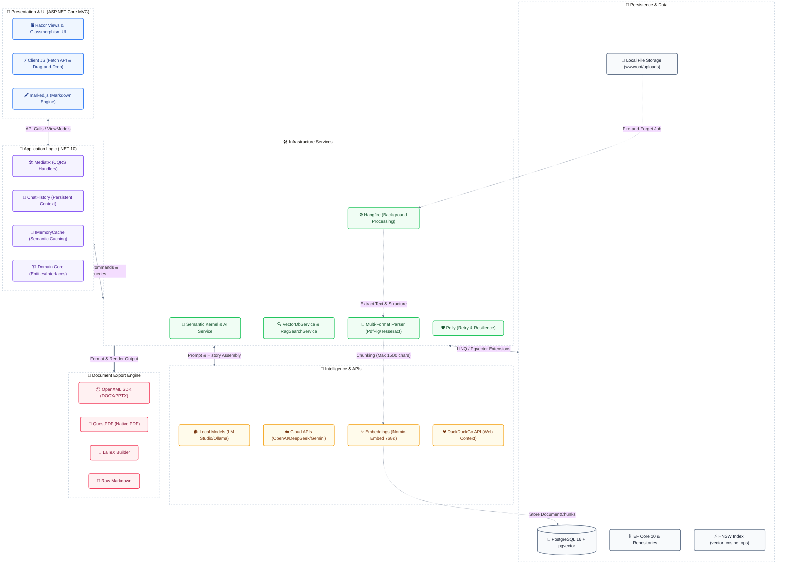

# GraspIt — AI-Powered Academic Assistant

GraspIt is an advanced academic ecosystem that leverages Retrieval-Augmented Generation (RAG) and structural document analysis to provide a contextual chat experience and high-fidelity automated exam generation.

---

## 🏗️ System Architecture

The diagram below illustrates the end-to-end data flow, service orchestration, and the high-fidelity document generation pipeline.

---

## 🚀 Core Workflows & Intelligence

### 1. RAG-Powered Contextual Search
GraspIt doesn't just "chat"—it thinks within the scope of your knowledge:
- **Document-Scoped Queries**: Select specific textbooks or notes to narrow the AI's search space via the sidebar document pills.
- **HNSW Vector Search**: Uses Hierarchical Navigable Small World indexes in `pgvector` for sub-second retrieval across massive document sets.
- **Semantic Caching**: Duplicate queries are served instantly via `IMemoryCache`, reducing LLM API latency and costs.

### 2. Structural Document Analysis
The high-fidelity generation starts with understanding. The `DocumentExtractionService` performs a deep structural scan:
- **Bloom's Taxonomy (BT)**: Automatically extracts and maps cognitive levels (L1-L6) from reference papers.
- **Course Outcome (CO)**: Detects and maps specific course outcomes to questions.
- **Layout Cloning**: Identifies institution headers, section patterns (PART A, SECTION 1), and question table grids.

### 3. The "High-Fidelity" Export Pipeline
GraspIt solves the "LLM formatting" problem through a hybrid generation strategy:
- **JSON-to-DOCX**: The AI outputs structured JSON, which is fed into a **Node.js** engine (`docx` library) to construct a pixel-perfect Microsoft Word document matching the NITTE university format.
- **LibreOffice PDF Path**: For the highest quality PDF output, the system uses **LibreOffice CLI** to convert generated DOCX files, ensuring table borders and university logos are preserved exactly.
- **QuestPDF Fallback**: A native C# rendering engine ensures reliability even if external tools are unavailable.

### 4. Advanced UX Features
- **Web Search Integration**: A dedicated toggle seamlessly injects real-time web context via the DuckDuckGo API into your prompts.
- **Persistent Chat Memory**: The AI naturally remembers the context of your entire conversation via Semantic Kernel's native `ChatHistory` state.
- **Extended Parsing Engine**: Beyond PDFs, the system supports Word (.docx), PowerPoint (.pptx) via OpenXML, and Images (.jpeg, .png) via Tesseract OCR.
- **Reasoning Process**: Automatic detection and expansion of `<think>` tags (from reasoning models like DeepSeek R1) into collapsible UI elements.
- **Smart Folder Organization**: A native HTML5 drag-and-drop system allows you to organize chat sessions into custom folders with live session counts.
- **Interactive UI Elements**: Clean, non-overlapping Copy buttons positioned via Flexbox for quick code and text extraction.
- **Resilience**: Every AI call is wrapped in **Polly** policies for 3x retries with exponential backoff, handling transient network or local LLM failures.

---

## 🛠️ Technology Stack

| Layer | Key Technologies |
| :--- | :--- |
| **Backend Core** | .NET 10, MediatR (CQRS), AutoMapper, Polly |
| **Presentation** | ASP.NET Core MVC, Bootstrap 5, marked.js |
| **Intelligence** | Semantic Kernel, pgvector, HNSW, nomic-embed |
| **Background** | Hangfire, PdfPig |
| **Export Engines** | Node.js, LibreOffice CLI, OpenXML SDK, QuestPDF |
| **Persistence** | PostgreSQL 16 (Docker-optimized) |

---

## 📖 Further Documentation

For deep dives into the database schema, API endpoints, or setup instructions, please refer to the [Detailed Documentation](file:///c:/GitHub/GraspIt/DOCUMENTATION.md).